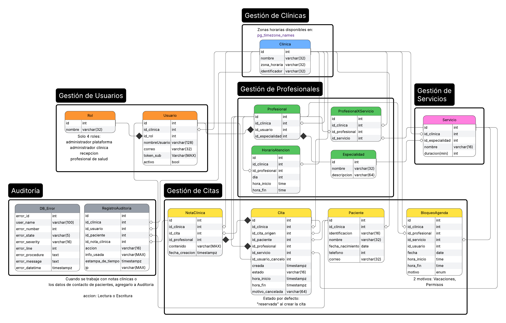

# MediCitas API — Servicio HTTP contenerizado con Docker Compose

Servicio REST de **gestión de citas médicas multi-clínica** en **ASP.NET Core 8** con persistencia en
**PostgreSQL**, caché de disponibilidad en **Redis**, autenticación delegada en **Keycloak** (JWT/OIDC, sin login propio) y
orquestación completa con **Docker Compose**.

El sistema completo se levanta con **un solo comando** y queda operativo sin pasos
manuales: el esquema y la semilla se cargan solos, el realm de Keycloak se importa solo y los healthchecks
ordenan el arranque.

```
┌────────────────────────  red Docker (Compose)  ────────────────────────┐
│                                                                        │
│   ┌──────────────┐   por nombre de servicio   ┌─────────────────────┐  │
│   │  api (app)   │ ◄────────────────────────► │  bd (PostgreSQL 16) │  │
│   │ :8080        │   bd:5432 (restaurantdb)   │ :5432  + volumen    │  │
│   └──┬────────┬──┘                            └─────────────────────┘  │
│      │        │ por nombre de servicio                                 │
│      │        │ redis:6379 (caché de disponibilidad RF7)               │
│      │        ▼                                                        │
│      │   ┌─────────────────────┐                                       │
│      │   │  redis (Redis 7.4)  │                                       │
│      │   │ :6379               │                                       │
│      │   └─────────────────────┘                                       │
│      │ por nombre de servicio                                          │
│      │ auth:8080 (OIDC: validación de JWT)                             │
│      ▼                                                                 │
│   ┌─────────────────────┐                                              │
│   │  auth (Keycloak 26) │  realm restaurant (importado al arrancar)    │
│   │ :8080 (host:8081)   │  client restaurant-api                       │
│   └─────────────────────┘                                              │
└────────────────────────────────────────────────────────────────────────┘
```

**Puertos publicados al host:** API en `http://localhost:8080`, Keycloak en
`http://localhost:8081`, PostgreSQL en `localhost:5432`.

Documentación complementaria en [`docs/DISENO.md`](docs/DISENO.md) y [`docs/PRUEBAS.md`](docs/PRUEBAS.md).

---

## 1. Requisitos previos

- **Docker** con el plugin **Docker Compose** (v2).
- Ningún otro requisito para el arranque: la imagen del servicio se construye desde el
  repositorio y las imágenes oficiales (`postgres`, `redis`, `keycloak`) se descargan solas.
- Para **correr las pruebas** se puede usar directamente la etapa `tests` del `Dockerfile` o el **.NET SDK 8** local (sección 5).

---

## 2. Diseño de la base de datos

El diseño está en PostgreSQL 15+ y se instala con `001-schema.sql` junto con los datos semilla en `002-seed.sql`. El detalle del diccionario de datos y planes de ejecución está en [`docs/DISENO.md`](docs/DISENO.md).

**Diseño de la base de datos**

El siguiente diagrama representa el diseño de la base de datos de forma visual:


**Estrategias de aislamiento entre clínicas**

Cada clínica es un tenant y sus datos no deben ser accesibles desde otra. Hay tres formas de lograrlo:

- **Esquema por tenant:** cada clínica tiene su propio esquema con copias de todas las tablas. Aísla bien, pero cada cambio de estructura debe replicarse en todos los esquemas, y el mantenimiento, las migraciones y el catálogo de objetos crecen con la cantidad de clínicas.
- **Columna discriminadora:** todas las clínicas comparten las mismas tablas y cada fila lleva el `id_clinica` al que pertenece. Hay una sola estructura que mantener, sin importar cuántas clínicas existan, pero el aislamiento depende de filtrar siempre por esa columna.
- **Row-Level Security (RLS):** mecanismo de PostgreSQL que aplica políticas por fila y obliga a la base a filtrar, aunque la consulta olvide el `WHERE`. No es una alternativa a la columna discriminadora: la refuerza.

**Se eligió la columna discriminadora**, porque el esquema por tenant puede volverse difícil de mantener cuando crece el número de clínicas.

**Multi-tenancy en el schema**

- `clinica.id` es el tenant. Toda tabla propia de una clínica lleva `id_clinica NOT NULL` y usa PK compuesta `(id_clinica, id)`.
- Las FK entre tablas del tenant también son compuestas, así la base impide referenciar datos de otra clínica (por ejemplo, una cita con un paciente ajeno).
- Son globales, sin `id_clinica`: `clinica`, `rol` y `especialidad`. `usuario` tiene PK simple, porque el administrador de plataforma no pertenece a ninguna clínica (`id_clinica` nulo).
- **Desnormalización deliberada:** `id_clinica` se repite en las tablas hijas aunque podría deducirse por JOIN. Esto rompe la 3FN a propósito, para filtrar por tenant sin subconsultas, indexar por tenant y aplicar el RLS directamente sobre cada tabla. La redundancia no puede quedar inconsistente: las FK compuestas obligan a que el `id_clinica` de la fila hija coincida con el de su padre.

**Módulo adicional: RLS**

El módulo adicional implementado es el Row-Level Security:

- El backend fija el tenant y el rol al inicio de cada transacción: `SET LOCAL ROLE <rol>; SELECT set_config('app.id_clinica', '<id>', TRUE);`, tomados del token ya validado.
- Todas las tablas con `id_clinica` (más `usuario` y `clinica`) tienen RLS activado y forzado, con una política que exige `id_clinica = app_id_clinica()` al leer y al escribir. Sin contexto definido no se ve ni se escribe ninguna fila.
- Se definen roles de base de datos con menor privilegio alineados a la matriz (`app_plataforma`, `app_admin_clinica`, `app_recepcion`, `app_profesional`, agrupados en `app_medicitas`).
- La bitácora `registro_auditoria` solo admite `INSERT` y `SELECT`.

**Transacciones mediante procedimientos almacenados**

Todas las operaciones se realizan llamando a los procedimientos almacenados (`SP_*`), uno por cada consulta o proceso requerido (reservar, reprogramar o cancelar citas, registrar pacientes y notas, consultar la agenda, la bitácora, etc.):

- Cada SP ejecuta su lógica dentro de un bloque con manejo de errores: si algo falla, se deshace lo hecho en ese bloque, se registra el error en `db_error` y se devuelve un código en `OutResult` (0 éxito, 403, 404, 409, 422 o 500).
- El backend abre la transacción, fija el tenant, llama al SP y hace `COMMIT`:

```sql
BEGIN;
SET LOCAL ROLE app_recepcion;
SELECT set_config('app.id_clinica', '1', TRUE);
CALL SP_ReservarCita('recepcion1', 1, 1, 1, '2026-11-23 09:00-06', NULL, NULL);  -- (outidcita, outresult)
COMMIT;
```

- Los procedimientos de consulta devuelven su resultado en un cursor (`OutCursor`), que se lee con `FETCH` dentro de la misma transacción.
- Los parámetros de entrada llevan el prefijo `In` y los de salida `Out`.

**Integridad de las reglas de negocio**

Las reglas críticas las garantiza la base, no solo la aplicación:

| Regla | Mecanismo |
|---|---|
| Sin solapes de citas vigentes (profesional y paciente) | Restricciones `EXCLUDE` sobre el rango de tiempo; también atienden las reservas simultáneas |
| Cita dentro del horario y fuera de bloqueos; duración fijada por el servicio; sin reservas en el pasado | Trigger en el alta de la cita |
| Estados de la cita y reprogramación atómica | Triggers de transición; los estados finales no admiten salida |
| Nota clínica solo de citas atendidas y del profesional que las atendió | Trigger y restricción única |
| Bitácora append-only | Sin políticas de modificación, privilegios revocados y triggers que lo rechazan |

---

## 3. Puesta en marcha (reproducible)

**Previo (una sola vez):**

```bash
cp .env.example .env     # y ajustar valores si se desea (los de ejemplo funcionan)
```

**Arrancar el sistema completo:**

```bash
docker compose up -d --build
```

Este único comando:

1. crea la red, el **volumen** de PostgreSQL (`postgres_data`) y los cuatro servicios (`bd`, `redis`, `auth`, `api`);
2. inicia **PostgreSQL** y **Redis** y espera a que estén sanos;
3. inicializa la base `keycloakdb` (script `db/init`) e inicia **Keycloak**, que importa
   el realm versionado `keycloak/realm-export.json` (`--import-realm`);
4. cuando sus dependencias están sanas, inicia la **API**, que carga `001-schema.sql` y `002-seed.sql`
   si la base está vacía y arranca escuchando en `:8080`.

**Verificar que el sistema quedó arriba y sano:**

```bash
docker compose ps          # los cuatro servicios en estado "healthy"
curl -s http://localhost:8080/health   # {"status":"healthy"} -> 200
curl -s http://localhost:8080/ready    # {"status":"ready"}   -> 200
```

> `/health` responde **sin tocar la base** (liveness). `/ready` comprueba la conexión a
> PostgreSQL y Redis (readiness): `200` si responden, `503` si no.

**Probar un ciclo con y sin token** validando la firma contra Keycloak:

```bash
# 1. Sin token -> 401
curl -s -o /dev/null -w "%{http_code}\n" http://localhost:8080/api/pacientes

# 2. Obtener token del usuario "recepcion1" (Clínica 1, contraseña por defecto MediCitas123!)
TOKEN=$(curl -s -X POST http://localhost:8081/realms/restaurant/protocol/openid-connect/token \
  -d "grant_type=password" -d "client_id=restaurant-api" \
  -d "username=recepcion1" -d "password=MediCitas123!" \
  | python3 -c "import sys,json;print(json.load(sys.stdin)['access_token'])")

# 3. Consultar identidad y pacientes de la clínica -> 200
curl -s -H "Authorization: Bearer $TOKEN" http://localhost:8080/api/yo
curl -s -H "Authorization: Bearer $TOKEN" http://localhost:8080/api/pacientes

# 4. Consultar disponibilidad (RF7, caché en Redis) -> 200
curl -s -H "Authorization: Bearer $TOKEN" \
  "http://localhost:8080/api/disponibilidad?profesionalId=1&servicioId=1&fecha=2026-11-23"

# 5. Operación no permitida para recepción (consultar auditoría RF19) -> 403
curl -s -o /dev/null -w "%{http_code}\n" \
  -H "Authorization: Bearer $TOKEN" http://localhost:8080/api/auditoria
```

---

## 4. Contrato de rutas

### Salud y disponibilidad (abiertas, sin token)

| Método | Ruta | Descripción | Respuesta |
|---|---|---|---|
| `GET` | `/health` | **Liveness**. No toca la base de datos. | `200` `{"status":"healthy"}` |
| `GET` | `/ready` | **Readiness**. Verifica la conexión a PostgreSQL y Redis. | `200` `{"status":"ready"}` o `503` |

### Rutas del dominio MediCitas (`/api/*`, requieren JWT Bearer)

| Método | Ruta | Roles permitidos | Requisito | Respuestas |
|---|---|---|---|---|
| `GET` | `/api/yo` | Todos los roles | `RF17` | `200` / `401` / `403` |
| `POST` | `/api/clinicas` | `platform-admin` | `RF1` | `201` / `400` / `403` / `409` |
| `GET` | `/api/usuarios` | `clinic-admin` | `RF2` | `200` / `403` |
| `POST` | `/api/usuarios` | `clinic-admin` | `RF2` | `201` / `400` / `403` / `409` |
| `PUT` | `/api/usuarios/{id}` | `clinic-admin` | `RF2` | `200` / `400` / `404` |
| `DELETE` | `/api/usuarios/{id}` | `clinic-admin` | `RF2` | `204` / `404` |
| `GET` | `/api/servicios` | `clinic-admin`, `reception`, `professional` | `RF3` | `200` |
| `POST` | `/api/servicios` | `clinic-admin` | `RF3` | `201` / `400` / `409` |
| `PUT` | `/api/servicios/{id}` | `clinic-admin` | `RF3`, `I8` | `200` / `400` / `404` |
| `GET` | `/api/profesionales` | `clinic-admin`, `reception`, `professional` | `RF4` | `200` |
| `POST` | `/api/profesionales` | `clinic-admin` | `RF4` | `201` / `400` / `409` |
| `PUT` | `/api/profesionales/{id}` | `clinic-admin` | `RF4`, `I8` | `200` / `400` / `404` |
| `GET` | `/api/profesionales/{id}/horarios` | `clinic-admin`, `reception`, `professional` | `RF5` | `200` / `403` |
| `POST` | `/api/profesionales/{id}/horarios` | `clinic-admin` | `RF5`, `I8` | `201` / `400` / `409` |
| `DELETE` | `/api/horarios/{id}` | `clinic-admin` | `RF5`, `I8` | `204` / `404` |
| `GET` | `/api/profesionales/{id}/bloqueos` | `clinic-admin`, `reception`, `professional` | `RF6` | `200` / `403` |
| `POST` | `/api/profesionales/{id}/bloqueos` | `clinic-admin` | `RF6`, `I8` | `201` / `400` |
| `DELETE` | `/api/bloqueos/{id}` | `clinic-admin` | `RF6`, `I8` | `204` / `404` |
| `GET` | `/api/disponibilidad` | `clinic-admin`, `reception`, `professional` | `RF7`, `I8` | `200` / `400` / `404` |
| `GET` | `/api/disponibilidad/servicios/{servicioId}` | `clinic-admin`, `reception` | `RF8` | `200` / `400` / `404` |
| `GET` | `/api/pacientes` | `clinic-admin`, `reception`, `professional` | `RF14`, `I5` | `200` / `403` |
| `GET` | `/api/pacientes/{id}` | `clinic-admin`, `reception`, `professional` | `RF14`, `RF18` | `200` / `404` |
| `POST` | `/api/pacientes` | `clinic-admin`, `reception` | `RF14`, `RF18` | `201` / `400` / `409` |
| `PUT` | `/api/pacientes/{id}` | `clinic-admin`, `reception` | `RF14`, `RF18` | `200` / `400` / `404` |
| `GET` | `/api/pacientes/{id}/historial` | `clinic-admin`, `reception`, `professional` | `RF14` | `200` |
| `POST` | `/api/citas` | `clinic-admin`, `reception` | `RF9`, `I1`–`I4`, `I7`, `I8` | `201` / `400` / `409` |
| `GET` | `/api/citas/{id}` | `clinic-admin`, `reception`, `professional` | `RF9`, `RF16` | `200` / `403` / `404` |
| `POST` | `/api/citas/{id}/reprogramar` | `clinic-admin`, `reception` | `RF10`, `I1`–`I4`, `I8` | `200` / `400` / `409` |
| `POST` | `/api/citas/{id}/cancelar` | `clinic-admin`, `reception` | `RF11`, `RF13`, `I8` | `200` / `400` / `409` |
| `POST` | `/api/citas/{id}/desenlace` | `clinic-admin`, `reception`, `professional` | `RF12`, `RF13`, `I8` | `200` / `400` / `403` / `409` |
| `POST` | `/api/citas/{id}/nota` | `professional` (autor de la cita) | `RF15`, `RF18` | `201` / `400` / `403` / `409` |
| `GET` | `/api/citas/{id}/nota` | `professional` | `RF15`, `RF18` | `200` / `404` |
| `GET` | `/api/agenda` | `clinic-admin`, `reception`, `professional` | `RF16` | `200` / `400` / `403` |
| `GET` | `/api/estadisticas/citas` | `clinic-admin`, `reception` | `RF20` | `200` / `400` |
| `GET` | `/api/auditoria` | `clinic-admin` | `RF19` | `200` / `403` |

---

## 5. Pruebas (unitarias + integración)

Con la pila arriba (`docker compose up -d`), correr **todas** las pruebas con un solo comando:

```bash
docker build --target tests -t medicitas-tests . && docker run --rm --network host medicitas-tests
```

O con el SDK de .NET 8 instalado localmente:

```bash
dotnet test Project_Restaurant_API.Tests/Project_Restaurant_API.Tests.csproj
```

Esperado: **33 passed** (unitarias + integración). El detalle de qué prueba cubre cada requisito funcional e invariante está en [`docs/PRUEBAS.md`](docs/PRUEBAS.md).

**Solo unitarias** (sin requerir contenedores activos):

```bash
docker run --rm --network host medicitas-tests --filter "FullyQualifiedName~Unit"
```

---

## 6. Verificar la persistencia tras un reinicio

Los datos viven en el **volumen** `postgres_data`, no en la app:

```bash
# 1. Bajar el sistema SIN borrar volúmenes
docker compose down

# 2. Volver a levantar
docker compose up -d

# 3. Verificar que las clínicas y pacientes siguen presentes
curl -s -H "Authorization: Bearer $TOKEN" http://localhost:8080/api/pacientes
```

> Usar `docker compose down` **sin** la bandera `-v`. Con `-v` se borra el volumen y los
> datos se pierden (útil para volver a un estado limpio, no para esta comprobación).

---

## 7. Apagar el sistema

```bash
docker compose down             # detiene y borra los contenedores, conserva el volumen
docker compose down -v          # idem, pero BORRA el volumen (pierde los datos)
docker compose down --rmi local # además elimina las imágenes locales construidas
```

---

## 8. Configuración (variables de entorno)

La imagen y el código **no contienen secretos**. Todo se inyecta por entorno usando
`.env.example` como plantilla; el `.env` real está en `.gitignore` y nunca se versiona.

| Variable | Descripción | Ejemplo |
|---|---|---|
| `API_PORT` / `KC_PORT` / `PG_PORT` | Puertos publicados al host de la API, Keycloak y PostgreSQL | `8080` / `8081` / `5432` |
| `TAG_PG` / `TAG_KC` | Tags de las imágenes `postgres` y `keycloak` | `16-alpine` / `26.0.8` |
| `POSTGRES_USER` / `POSTGRES_PASSWORD` / `POSTGRES_DB` | Credenciales de bootstrap y base de datos | `postgres` / `secretodesk` / `restaurantdb` |
| `APP_DB_USER` / `APP_DB_PASSWORD` | Usuario de aplicación sin privilegios de superusuario | `medicitas_app` / `medicitas-local-pass` |
| `REDIS_CONNECTION` | Endpoint de Redis en la red de Compose | `redis:6379` |
| `KC_BOOTSTRAP_ADMIN_USERNAME` / `KC_BOOTSTRAP_ADMIN_PASSWORD` | Admin del realm `master` | `admin` / `admin` |
| `KEYCLOAK_AUTHORITY` / `KEYCLOAK_VALID_ISSUER` | Emisor OIDC por nombre de servicio | `http://auth:8080/realms/restaurant` |
| `MED_TEST_PASSWORD` | Contraseña de los usuarios de prueba en Keycloak | `MediCitas123!` |
| `MED_ADMIN_CLIENT_SECRET` | Secret del cliente de aprovisionamiento en Keycloak | `medicitas-provisioning-local` |

---

## 9. Autenticación con Keycloak

- El servicio **no** implementa login ni firma de tokens; solo **valida** los JWT que
  recibe contra el proveedor (`AddJwtBearer` + `options.Authority`).
- El realm `restaurant` está versionado en `keycloak/realm-export.json` y se importa al
  arrancar Keycloak (`start-dev --import-realm`). Contiene los roles `platform-admin`, `clinic-admin`, `reception` y `professional`, junto con los usuarios de prueba (`plataforma`, `admin1..3`, `recepcion1..3`, `profesional1..3`, `profesional1b..3b`).
- El rol llega en `realm_access.roles`; `Auth/KeycloakClaimsTransformation.cs` lo
  extrae y lo expone como `ClaimTypes.Role`.
- A partir del claim `sub`, la API resuelve el usuario y su `id_clinica` en PostgreSQL (`SP_ResolverIdentidad`). Sin token o token inválido → **401**; rol inadecuado o clínica ajena → **403**.

---

## 10. Inicialización automática del esquema

Al arrancar, `scripts/api-entrypoint.sh` ejecuta `dotnet Project_Restaurant_API.dll --initialize-only` con reintentos contra la base: si las tablas del dominio no existen, ejecuta `001-schema.sql` y `002-seed.sql`, configura el usuario `medicitas_app` y luego limpia las variables de bootstrap antes de iniciar el servidor web. **No hay que cargar esquemas a mano.**

---

## 11. Decisiones de contenerización (`Dockerfile`)

| Decisión | Justificación |
|---|---|
| `FROM mcr.microsoft.com/dotnet/sdk:8.0 AS build` | Imagen **base oficial** de Microsoft para .NET 8 para compilar y publicar el servicio. |
| Etapa `FROM build AS tests` | Permite ejecutar `dotnet test` dentro de Docker sin depender del SDK instalado en el host. |
| Etapa de ejecución `FROM mcr.microsoft.com/dotnet/aspnet:8.0` | **Multi-stage**: la imagen final lleva solo el runtime ASP.NET, sin SDK ni herramientas de compilación. |
| `.dockerignore` | Excluye `.git`, `bin/`, `obj/`, `.env*` y documentación para reducir el contexto de compilación. |
| `ENTRYPOINT ["/app/api-entrypoint.sh"]` | Inicializa la base de datos de forma idempotente y arranca el proceso en `:8080`. |

---

## 12. Decisiones de orquestación (`docker-compose.yml`)

| Decisión | Justificación |
|---|---|
| Red por **nombre de servicio** (`bd`, `redis`, `auth`) | La app alcanza la base, la caché y el proveedor por nombre de servicio en la red de Compose. |
| Volumen `postgres_data` | Los datos de PostgreSQL residen en un volumen declarado que sobrevive a `down`/`up`. |
| `healthcheck` en los cuatro servicios | `bd` usa `pg_isready`; `redis` usa `redis-cli ping`; `auth` consulta `/health/ready`; `api` consulta `/health`. |
| `depends_on: condition: service_healthy` | La API espera a que PostgreSQL, Redis y Keycloak estén sanos antes de iniciar. |
| `--import-realm` + `keycloak/realm-export.json` | El realm se importa solo al arrancar con cero pasos manuales en la consola de Keycloak. |

---

## 13. Estructura del repositorio

```
.
├── Dockerfile
├── docker-compose.yml
├── .env.example               # plantilla de configuración (versionada)
├── .dockerignore              # excluye de la imagen lo que no corresponde
├── .gitignore                 # .env, bin/obj, etc. fuera del repositorio
├── db/init/01-keycloak-db.sql # base exclusiva de Keycloak (1er arranque del volumen)
├── keycloak/realm-export.json # realm de Keycloak importado al arrancar
├── docs/
│   ├── DISENO.md              # diseño del modelo, multi-tenancy, RLS, caché e índices
│   ├── PRUEBAS.md             # trazabilidad de pruebas a RF1..RF21 e I1..I8
│   └── imgs/                  # diagrama de la base de datos
├── README.md
├── Project_Restaurant_API/                    # servicio ASP.NET Core 8
│   ├── Program.cs                             # config, auth JWT, /health, /ready, Redis
│   ├── Auth/KeycloakClaimsTransformation.cs   # roles de Keycloak → ClaimTypes.Role
│   └── MediCitas/                             # controladores, acceso a SP_*, caché Redis y SQL
└── Project_Restaurant_API.Tests/              # pruebas unitarias y de integración
```

---

## 14. Declaración de uso de IA

Se utilizó inteligencia artificial como apoyo puntual para desarrollar y revisar algunas tareas específicas del proyecto:

##### [Josimar Araya]()

- k6 – Pruebas de integración: Para facilitar la estructuración y revisión de los scripts de pruebas automatizadas sobre los endpoints ya definidos por el proyecto
- k6 – Autenticación y persistencia: Apoyo en validación de escenarios con tokens de Keycloak, respuestas 401/403 y comprobaciones de persistencia desde las pruebas
- Kubernetes – Manifiestos: Parcialmente para generar y revisar general de los Deployments, Services, PVC, ConfigMap, Secret y probes necesarios para desplegar el sistema
- Kustomize y kind: Se utilizó para estructurar base/ y overlays/, configurar el clúster local con kind y revisar los comandos de despliegue
- Además se usó en general para revisar y validar algunos códigos y flujo de proceso además de arreglar errores, fallas generales y problemas de código

##### [Franco Rojas](https://github.com/frarojas)

- Apoyo en la conexión del backend con los procedimientos almacenados de PostgreSQL (`SP_*`) y el manejo de la caché en Redis.
- Apoyo puntual para adaptar las pruebas automatizadas al esquema de la base de datos y depurar errores de integración.
- Consulta rápida de documentación y revisión de formato en archivos Markdown.

##### [José Jiménez](https://github.com/JoseJimenez01)

- Refrescar términos, explicación del funcionamiento de algunas cosas(tecnologías, conexión entre componentes, etc).
- Solución de errores.
- Consultar la documentación rápidamente en busca de buenas prácticas de uso de cierta tecnología.
- Si fuera el caso, para generar data de una BD, o generar los tests de prueba.
