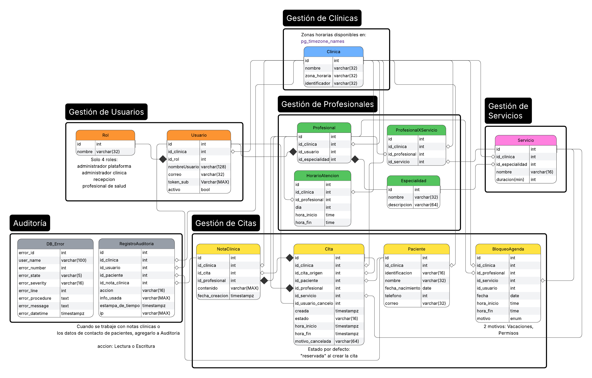

# Diseño de la Base de Datos y Arquitectura — MediCitas

Complemento técnico de la sección 2 del [`README.md`](../README.md): normalización, diccionario de datos, comparación de estrategias de multi-tenancy y RLS, concurrencia, caché en Redis e índices con `EXPLAIN ANALYZE`.

---

## 1. Diagrama Entidad-Relación y Normalización (3FN)



### Justificación de 3FN y desnormalización controlada

1. **1FN (Atributos atómicos):** todas las columnas guardan valores escalares simples. Los servicios que brinda cada profesional se separan en `profesional_x_servicio` y las franjas horarias en filas de `horario_atencion`.
2. **2FN (Dependencia completa de la clave):** en las tablas con PK compuesta `(id_clinica, id)` o `(id_clinica, id_profesional, id_servicio)`, ningún atributo no clave depende solo de una parte de la clave; los datos del servicio viven en `servicio` y los del profesional en `profesional`.
3. **3FN (Sin dependencias transitivas):** los catálogos `rol` y `especialidad` están separados; las notas clínicas están en `nota_clinica` (solo para citas atendidas) y la duración se define en `servicio.duracion_min` (`hora_fin` en `cita` se calcula por trigger al insertar para indexar el rango con `tstzrange`).
4. **Desnormalización deliberada (`id_clinica`):** se repite `id_clinica` en las tablas hijas para formar PK y FK compuestas `(id_clinica, id)`. Esto impide en el motor referenciar registros de otra clínica (`I5`), permite indexar con prefijo `id_clinica` y evita subconsultas en las políticas de RLS.

---

## 2. Diccionario de Datos

### Tipos `ENUM`
- `motivo_bloqueo`: `'vacaciones'`, `'permisos'`, `'capacitaciones'`, `'cierre_clinica'`.
- `estado_cita`: `'reservada'`, `'reprogramada'`, `'cancelada'`, `'atendida'`, `'ausente'`.
- `accion_auditoria`: `'lectura'`, `'escritura'`.

### Tablas

| Tabla | Clave Primaria | Claves Foráneas y Restricciones Principales | Propósito |
|---|---|---|---|
| `clinica` | `(id)` | `UNIQUE (cedula_juridica)`, trigger valida `zona_horaria` | Tenant (clínica médica, `RF1`). |
| `rol` | `(id)` | `UNIQUE (nombre)` | Roles: plataforma (`1`), admin (`2`), recepción (`3`), profesional (`4`). |
| `especialidad` | `(id)` | `UNIQUE (nombre)` | Catálogo de especialidades médicas (`RF3`, `RF4`). |
| `usuario` | `(id)` | `FK -> clinica`, `FK -> rol`, `UNIQUE (token_sub)`, `UNIQUE (id_clinica, id)` | Usuarios vinculados al `sub` de Keycloak (`RF2`, `RF17`). |
| `servicio` | `(id_clinica, id)` | `FK -> clinica`, `FK -> especialidad`, `CHECK (duracion_min BETWEEN 1 AND 480)` | Servicios médicos y su duración (`RF3`, `I4`). |
| `profesional` | `(id_clinica, id)` | `FK (id_clinica, id_usuario) -> usuario`, `FK -> especialidad` | Profesionales de salud activos en la clínica (`RF4`). |
| `profesional_x_servicio` | `(id_clinica, id_profesional, id_servicio)` | `FK -> profesional`, `FK -> servicio` | Servicios habilitados por profesional (`RF4`). |
| `horario_atencion` | `(id_clinica, id)` | `FK -> profesional`, `CHECK (dia BETWEEN 1 AND 7)`, `EXCLUDE USING gist (ex_horario_sin_solape)` | Bloques semanales de atención (`RF5`, `I3`). |
| `bloqueo_agenda` | `(id_clinica, id)` | `FK -> profesional`, `FK -> usuario`, `CHECK (hora_fin > hora_inicio)` | Excepciones/bloqueos de agenda (`RF6`, `I3`). |
| `paciente` | `(id_clinica, id)` | `FK -> clinica`, `UNIQUE (id_clinica, identificacion)` | Pacientes y datos de contacto auditados (`RF14`, `RF18`). |
| `cita` | `(id_clinica, id)` | `FK -> paciente, profesional, servicio`, `EXCLUDE USING gist` para profesional (`I1`) y paciente (`I2`) | Citas médicas y su ciclo de estados (`RF9`–`RF13`). |
| `nota_clinica` | `(id_clinica, id)` | `FK -> cita`, `FK -> profesional`, `UNIQUE (id_clinica, id_cita)` | Nota clínica de una cita atendida (`RF15`, `RF18`). |
| `registro_auditoria` | `(id_clinica, id)` | `FK -> usuario, paciente, nota_clinica`, triggers `append-only` (`I6`) | Bitácora inmutable de accesos a contacto y notas (`RF18`, `RF19`). |
| `db_error` | `(error_id)` | — | Registro de errores capturados en los procedimientos `SP_*`. |

---

## 3. Multi-Tenancy y Módulo Adicional (RLS)

| Criterio | Esquema por tenant | Columna discriminadora (`id_clinica`) | Columna discriminadora + RLS (Módulo adicional) |
|---|---|---|---|
| Mantenimiento y migraciones | Complejo: replicar DDL en cada esquema | Simple: un solo esquema `public` | Simple: un solo esquema `public` |
| Escalabilidad en catálogo | Crece con el número de clínicas | Constante (14 tablas) | Constante (14 tablas) |
| Seguridad ante olvido de `WHERE` | Aislado por `search_path` | Depende de incluir `WHERE id_clinica = ...` | **Filtrado forzoso en el motor** (`FORCE ROW LEVEL SECURITY`) |

### Comparación experimental: Sin RLS vs. Con RLS (sobre 55,943 citas)

Consulta de prueba: citas de un profesional en una semana (`id_clinica = 1`, `id_profesional = 1`).

- **Sin RLS (solo columna discriminadora):**
  ```text
  Bitmap Heap Scan on cita c  (cost=17.44..628.46 rows=7 width=28) (actual time=0.148..0.379 rows=33 loops=1)
    Recheck Cond: ((id_clinica = 1) AND (hora_inicio >= '2026-10-01 06:00:00+00') AND (hora_inicio < '2026-10-08 06:00:00+00'))
    Filter: (id_profesional = 1)
    Buffers: shared hit=100
    ->  Bitmap Index Scan on ix_cita_agenda_clinica  (cost=0.00..17.44 rows=412 width=0) (actual time=0.042..0.043 rows=420 loops=1)
  Planning Time: 0.049 ms | Execution Time: 0.394 ms
  ```

- **Con RLS activo (`SET LOCAL ROLE app_recepcion; SELECT set_config('app.id_clinica', '1', true)`):**
  ```text
  Result  (cost=17.46..628.48 rows=7 width=28) (actual time=0.051..0.088 rows=33 loops=1)
    One-Time Filter: ($0 = 1)
    Buffers: shared hit=100
    InitPlan 1 (returns $0)
      ->  Result  (cost=0.00..0.02 rows=1 width=4) (actual time=0.001..0.001 rows=1 loops=1)
    ->  Bitmap Heap Scan on cita c  (cost=17.46..628.48 rows=7 width=28) (actual time=0.049..0.084 rows=33 loops=1)
          ->  Bitmap Index Scan on ix_cita_agenda_clinica  (cost=0.00..17.44 rows=412 width=0) (actual time=0.019..0.019 rows=420 loops=1)
  Planning Time: 0.061 ms | Execution Time: 0.111 ms
  ```

Como `app_id_clinica()` es `STABLE`, PostgreSQL la evalúa una sola vez (`InitPlan 1`) y usa el mismo índice `ix_cita_agenda_clinica` leyendo exactamente los mismos 100 buffers sin sobrecosto apreciable.

---

## 4. Transacciones, Aislamiento y Pregunta Rectora

- **Nivel de aislamiento elegido:** `READ COMMITTED` junto con las restricciones GiST `ex_cita_profesional_sin_solape` (`I1`) y `ex_cita_paciente_sin_solape` (`I2`).
  - `REPEATABLE READ` no evita por sí solo que dos transacciones inserten filas nuevas en el mismo horario si no existe una restricción de índice.
  - `SERIALIZABLE` introduce bloqueos de predicado (`SIREAD`) que pueden abortar reservas concurrentes de horarios distintos del mismo profesional.
  - Con `READ COMMITTED` + `EXCLUDE USING gist`, solo se bloquean entre sí las reservas cuyos rangos `[hora_inicio, hora_fin)` realmente se solapan.

- **Respuesta a la pregunta rectora (*¿En qué punto exacto se serializan dos reservas que compiten por el mismo espacio y por qué basta?*):**
  - Se serializan al ejecutar el `INSERT INTO cita` dentro de `SP_ReservarCita` / `SP_ReprogramarCita`, cuando PostgreSQL verifica el índice GiST de la restricción `EXCLUDE` (`ex_cita_profesional_sin_solape` y `ex_cita_paciente_sin_solape`).
  - Cuando dos transacciones concurrentes insertan rangos que se solapan (`&&`), la segunda encuentra en el índice GiST la entrada aún no confirmada de la primera y el motor la pone en espera sobre el `XID` de la primera transacción (`XactLockTableWait`).
  - Al confirmar (`COMMIT`) la primera, la segunda despierta y falla con `SQLSTATE 23P01` (`exclusion_violation`), que el procedimiento captura, registra en `db_error` y devuelve como `OutResult = 409` (`HTTP 409 Conflict`).

---

## 5. Roles de Menor Privilegio y Auditoría `Append-Only`

- **Roles en PostgreSQL:** la aplicación conecta con `medicitas_app` (`NOBYPASSRLS`, `NOSUPERUSER`) y en cada transacción asume con `SET LOCAL ROLE`:
  - `app_plataforma`: solo `INSERT/SELECT` en `clinica` y `usuario` (`RF1`).
  - `app_admin_clinica`: catálogos, horarios, bloqueos, pacientes, citas y lectura de `registro_auditoria` (`RF19`), sin escritura en `nota_clinica`.
  - `app_recepcion`: lectura de catálogos/agenda y gestión de `paciente` y `cita`, sin acceso a `nota_clinica` ni `registro_auditoria`.
  - `app_profesional`: consulta de su agenda/pacientes, desenlace de sus citas (`RF12`) y creación/lectura de `nota_clinica` (`RF15`).
- **Bitácora inmutable (`I6`):** `registro_auditoria` tiene `REVOKE UPDATE, DELETE, TRUNCATE`, solo políticas RLS para `INSERT` y `SELECT`, y los triggers `trg_auditoria_no_update_delete` / `trg_auditoria_no_truncate` que rechazan cualquier modificación o borrado con `SQLSTATE 42501`.

---

## 6. Caché de Disponibilidad en Redis (`RF7`, `I7`, `I8`)

- **Clave y estructura:** Hash por clínica y profesional `med:disp:{idClinica}:{idProfesional}`, con campo `{idServicio}:{fecha:yyyy-MM-dd}` y TTL de respaldo de 5 minutos.
- **Política de invalidación (`I8`):** usar un Hash por profesional permite que, tras confirmar (`COMMIT`) cualquier reserva, reprogramación, cancelación, desenlace o cambio de horario/bloqueo/servicio, la API ejecute `DEL med:disp:{idClinica}:{idProfesional}` invalidando de inmediato todas las fechas cacheadas de ese profesional.
- **Fuente de verdad (`I7`):** `SP_ReservarCita` y `SP_ReprogramarCita` validan siempre en PostgreSQL, nunca desde Redis.

### Medición antes y después de la caché (`GET /api/disponibilidad`)

| Escenario | Corrida 1 | Corrida 2 | Corrida 3 | Promedio |
|---|---|---|---|---|
| **Sin caché (`cacheHit: false`, PostgreSQL)** | `9.87 ms` | `10.96 ms` | `10.26 ms` | **`10.36 ms`** |
| **Con caché (`cacheHit: true`, Redis)** | `1.98 ms` | `2.57 ms` | `2.02 ms` | **`2.19 ms`** |

---

## 7. Índices y Planes de Ejecución (`EXPLAIN ANALYZE`)

### Índices principales del esquema
- `ex_horario_sin_solape` (GiST en `horario_atencion`): evita solapes (`RF5`) y filtra por `(id_clinica, id_profesional, dia)` en `RF7`/`RF8`.
- `ex_cita_profesional_sin_solape` y `ex_cita_paciente_sin_solape` (GiST parciales en `cita`): garantizan `I1` e `I2`.
- `ix_cita_agenda_clinica` (`(id_clinica, hora_inicio, id_profesional)`): agenda del día (`RF16`) y conteo por estado (`RF20`).
- `ix_cita_profesional_inicio` (`(id_clinica, id_profesional, hora_inicio) WHERE estado IN ('reservada','atendida')`): disponibilidad (`RF7`, `RF8`) y conflictos de bloqueo (`RF6`).
- `ix_cita_paciente_historial` (`(id_clinica, id_paciente, hora_inicio DESC)`): historial de citas del paciente (`RF14`).
- `ix_auditoria_clinica_fecha`, `ix_auditoria_usuario`, `ix_auditoria_paciente`: filtros de auditoría (`RF19`).

### Planes de ejecución medidos (base con 55,943 citas y 70,033 registros de auditoría)

**1. Disponibilidad de un profesional (`RF7`):** usa `Index Scan using ex_horario_sin_solape` y `Bitmap Index Scan on ix_cita_profesional_inicio`.
```text
Sort  (cost=1374.50..1375.32 rows=329 width=16) (actual time=13.114..13.117 rows=13 loops=1)
  ->  Nested Loop  (cost=5.65..1358.21 rows=329 width=8) (actual time=9.019..13.088 rows=13 loops=1)
        ->  Index Scan using ex_horario_sin_solape on horario_atencion h  (actual time=6.509..6.511 rows=2 loops=1)
        ->  Nested Loop Anti Join  (actual time=1.404..3.286 rows=6 loops=2)
              ->  Bitmap Heap Scan on cita c  (actual time=0.213..1.304 rows=818 loops=1)
                    ->  Bitmap Index Scan on ix_cita_profesional_inicio  (actual time=0.173..0.174 rows=823 loops=1)
Planning Time: 1.362 ms | Execution Time: 13.214 ms
```

**2. Agenda del día (`RF16`):** usa `Bitmap Index Scan on ix_cita_agenda_clinica` y `Index Scan using pk_paciente`.
```text
Sort  (cost=188.17..188.18 rows=1 width=97) (actual time=0.379..0.381 rows=6 loops=1)
  ->  Nested Loop  (cost=5.32..188.06 rows=1 width=97) (actual time=0.206..0.367 rows=6 loops=1)
        ->  Bitmap Heap Scan on cita c  (actual time=0.157..0.256 rows=6 loops=1)
              ->  Bitmap Index Scan on ix_cita_agenda_clinica  (actual time=0.047..0.047 rows=65 loops=1)
        ->  Index Scan using pk_paciente on paciente p  (actual time=0.011..0.011 rows=1 loops=6)
Planning Time: 1.238 ms | Execution Time: 0.463 ms
```

**3. Bitácora de auditoría filtrada por paciente (`RF19`):** usa `Bitmap Index Scan on ix_auditoria_paciente`.
```text
Sort  (cost=339.81..340.10 rows=114 width=100) (actual time=4.515..4.528 rows=443 loops=1)
  ->  Nested Loop  (cost=10.93..335.86 rows=114 width=100) (actual time=0.236..4.354 rows=443 loops=1)
        ->  Index Scan using pk_paciente on paciente p  (actual time=0.048..0.049 rows=1 loops=1)
        ->  Hash Join  (actual time=0.187..4.271 rows=443 loops=1)
              ->  Bitmap Heap Scan on registro_auditoria a  (actual time=0.140..4.107 rows=443 loops=1)
                    ->  Bitmap Index Scan on ix_auditoria_paciente  (actual time=0.101..0.101 rows=443 loops=1)
Planning Time: 1.797 ms | Execution Time: 4.658 ms
```

**4. Conteo de citas por estado en un rango de fechas (`RF20`):** usa `Bitmap Index Scan on ix_cita_agenda_clinica`.
```text
Sort  (cost=792.69..792.70 rows=5 width=12) (actual time=3.121..3.123 rows=5 loops=1)
  ->  HashAggregate  (cost=792.56..792.61 rows=5 width=12) (actual time=3.103..3.104 rows=5 loops=1)
        ->  Hash Right Join  (actual time=0.257..2.987 rows=1779 loops=1)
              ->  Bitmap Heap Scan on cita c  (actual time=0.233..2.707 rows=1778 loops=1)
                    ->  Bitmap Index Scan on ix_cita_agenda_clinica  (actual time=0.221..0.221 rows=1778 loops=1)
Planning Time: 0.228 ms | Execution Time: 3.182 ms
```
